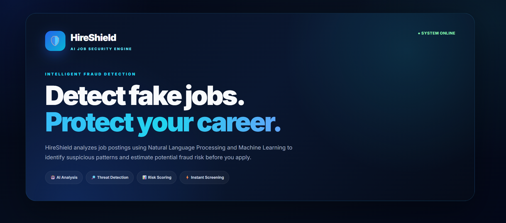
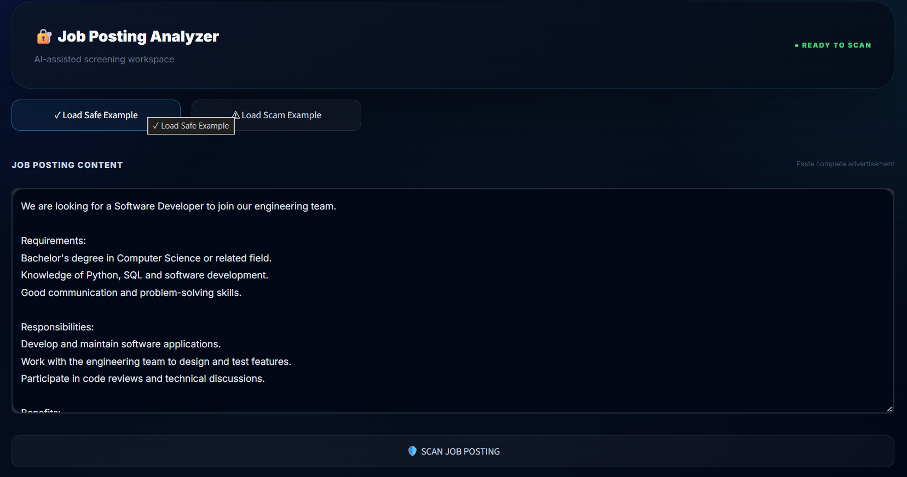
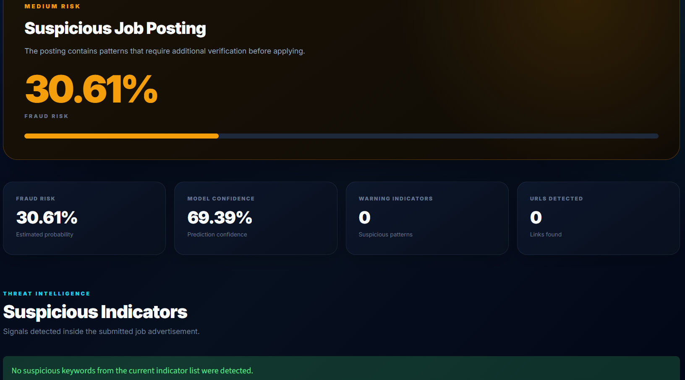
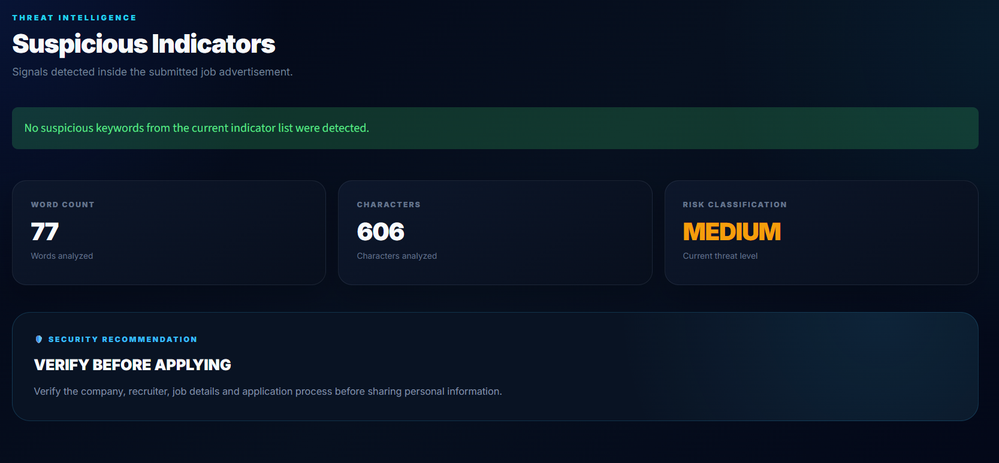
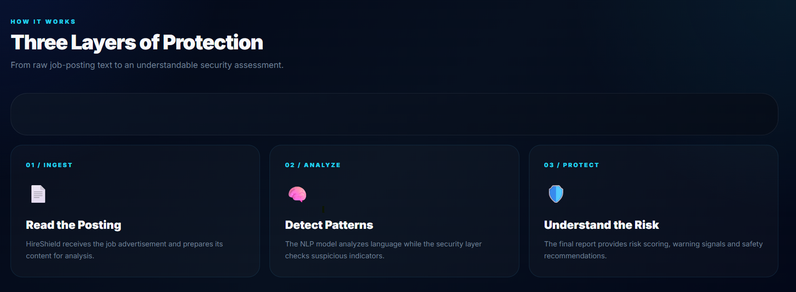

# HireShield — Fake Job Posting Detector

**An AI-powered application that identifies potentially fraudulent job postings using Natural Language Processing (NLP) and Machine Learning.**

HireShield analyzes job advertisement text, estimates its fraud risk, highlights suspicious keywords, and provides warnings to help users evaluate potentially misleading job opportunities.

## Project Overview

Online job scams can trick applicants with fake work-from-home offers, registration fees, unrealistic salaries, and requests for sensitive personal or banking information.

HireShield uses a machine-learning model to analyze job descriptions and flag postings that may be fraudulent.

## Features

- **AI-Powered Detection:** Uses TF-IDF text features and Logistic Regression.
- **Fraud Risk Assessment:** Displays an estimated fraud-risk score.
- **Suspicious Keyword Detection:** Highlights potentially concerning terms and phrases.
- **Interactive Dashboard:** Provides a Streamlit-based user interface.
- **Threat Intelligence:** Displays warning indicators and safety recommendations.
- **Machine Learning Pipeline:** Includes a script for training the detection model.

## Screenshots

### 1. Home Dashboard


### 2. Job Scanner


### 3. Fraud Detection Result


### 4. Threat Intelligence


### 5. How It Works


## Technologies Used

- Python
- Streamlit
- Pandas and NumPy
- Scikit-learn
- TF-IDF Vectorization
- Logistic Regression
- NLTK
- Joblib
- Matplotlib and Seaborn

## Machine Learning Workflow

1. **Text Collection:** Combine available job-posting fields, including the title, company profile, description, requirements, and benefits.
2. **Text Processing:** Handle missing text values and convert text into numerical TF-IDF features.
3. **Model Training:** Train a Logistic Regression classifier with class balancing.
4. **Evaluation:** Evaluate the model using a stratified train-test split.
5. **Prediction:** Analyze submitted job text and generate a fraud-risk estimate.
6. **Risk Explanation:** Display suspicious indicators and recommendations through the Streamlit interface.

## Model Performance

The model was evaluated using an 80/20 stratified train-test split.

| Metric | Result |
|---|---:|
| Test accuracy | 98.52% |
| Fake-job precision | 0.81 |
| Fake-job recall | 0.91 |
| Fake-job F1-score | 0.86 |
| Macro F1-score | 0.92 |

These results reflect the evaluation performed on this dataset split. Performance on new job postings may differ, and predictions should not be treated as definitive proof of fraud.

## Project Structure

```text
HireShield/
├── app.py
├── trainmodel.py
├── requirements.txt
├── .gitignore
├── models/
│   └── job_detector.pkl
└── screenshots/
    ├── 01_home.png
    ├── 02_scanner.png
    ├── 03_fraud_result.png
    ├── 04_threat_intelligence.png
    └── 05_how_it_works.png
```

The training dataset is not included in this repository.

## Installation and Setup

### Prerequisites

- Python 3.12 or a compatible Python version
- Git
- pip

### 1. Clone the repository

```bash
git clone https://github.com/andhavarapukrishnakanth2006-sketch/HireShield.git
cd HireShield
```

### 2. Create and activate a virtual environment

**Windows:**

```bash
python -m venv venv
venv\Scripts\activate
```

### 3. Install dependencies

```bash
pip install -r requirements.txt
```

### 4. Run HireShield

```bash
streamlit run app.py
```

Open the local URL displayed in your terminal, usually `http://localhost:8501`.

The repository includes the trained model, so you do not need the training dataset simply to run inference, provided the model and application dependencies are available.

## Training the Model

The training script requires the `fake_job_postings.csv` dataset in the `data/` directory.

1. Obtain the dataset from a legitimate source and verify its licence and usage terms.
2. Place the CSV at `data/fake_job_postings.csv`.
3. Run:

```bash
python trainmodel.py
```

The script should generate the trained model at the path configured in `trainmodel.py`.

## Safety Disclaimer

HireShield is an educational machine-learning project. Its predictions are estimates, not guarantees. Always verify employers through official websites and trusted communication channels. Never pay registration fees to secure a job or share banking credentials with unverified recruiters.

## Future Improvements

- Evaluate performance on newer and independent job-posting datasets.
- Add explainability for individual predictions.
- Improve multilingual job-posting support.
- Deploy the application to a public hosting platform.
- Add more comprehensive validation and automated tests.

## Author

**Krishnakanth Andhavarapu**

B.Tech — Computer Science and Engineering (Artificial Intelligence and Machine Learning)

GitHub: [@andhavarapukrishnakanth2006-sketch](https://github.com/andhavarapukrishnakanth2006-sketch)

---

*HireShield — Helping job seekers identify potentially fraudulent job postings through AI and NLP.*